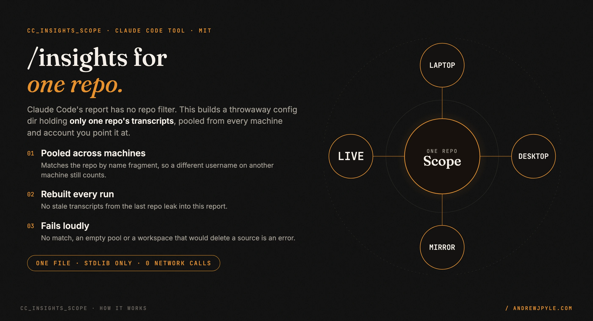
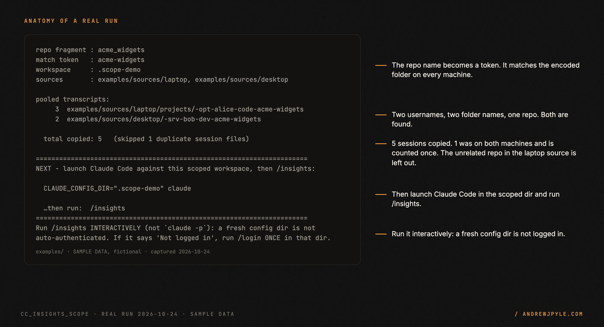
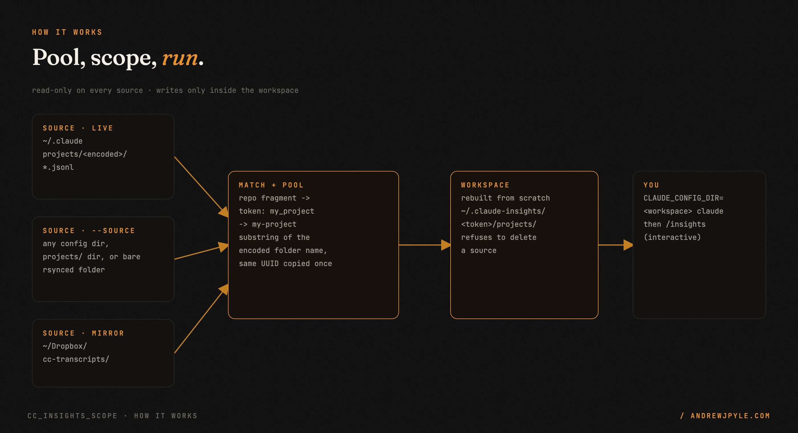

<p align="center">
  
</p>

<p align="center">
  <a href="https://github.com/andrewjpyle/cc_insights_scope/actions/workflows/ci.yml"></a>
  
  
</p>

# Run Claude Code's `/insights` on one repo, across every machine you use

`/insights` has no repo filter. It rebuilds its report from every `*.jsonl` transcript under the
active config dir's `projects/` folder, so on a machine where you touch a dozen projects you get one
blended report. A config dir is also per account and per machine, so a repo you work on from two
laptops produces two partial reports and no whole one.

`cc_insights_scope.py` is one stdlib Python file that fixes both without patching anything.

- **Scoped.** The report covers one repo and nothing else.
- **Pooled.** It merges transcripts from your live config dir, any folders you rsynced from other
  machines, and an optional shared-storage mirror.
- **Safe to rerun.** The workspace is rebuilt every time, and it refuses to delete anything it reads from.

> **The one idea worth stealing, even if you never run this code:** when a tool has no filter, give
> it a smaller world instead of patching the tool. `/insights` respects `CLAUDE_CONFIG_DIR`, so a
> config dir that contains only one repo's transcripts is a repo filter. Before: one report about
> every project on the machine. After: one report about the repo you named.

---

## 60 seconds to a scoped report

```bash
curl -O https://raw.githubusercontent.com/andrewjpyle/cc_insights_scope/main/cc_insights_scope.py
python3 cc_insights_scope.py my_project
```

Requires Python 3.9+ and Claude Code. No pip, no network calls, no config.

To try it without touching your own data, clone the repo and run the fictional demo. It pools two
pretend machines that hold the same repo under different usernames:

```bash
python3 cc_insights_scope.py acme_widgets \
    --default-source examples/sources/laptop --source examples/sources/desktop \
    --no-mirror --workspace .scope-demo
```

```
repo fragment : acme_widgets
match token   : acme-widgets
workspace     : .scope-demo
sources       : examples/sources/laptop, examples/sources/desktop

pooled transcripts:
     3  examples/sources/laptop/projects/-opt-alice-code-acme-widgets
     2  examples/sources/desktop/-srv-bob-dev-acme-widgets

  total copied: 5   (skipped 1 duplicate session files)
```

That output is from a real run, committed as `docs/assets/src/captures/demo_run.json`. The data in
`examples/` is fictional sample data. The real tool prints absolute paths.

<p align="center"></p>

Then launch Claude Code in the scoped workspace and run `/insights`:

```bash
CLAUDE_CONFIG_DIR="$HOME/.claude-insights/my-project" claude
```

## Pool across machines and accounts

A source root can be any of three shapes:

- a **config dir** (`~/.claude`, anything with a `projects/` child)
- a **`projects/` dir** itself
- a **bare folder of encoded project dirs**, which is what you get when you rsync from another machine

```bash
python3 cc_insights_scope.py my_project \
    --source ~/cc-sources/from-work-laptop \
    --source ~/cc-sources/from-desktop
```

| Option | Default | What it does |
|---|---|---|
| `repo` | required | Repo fragment, matched as a substring of the encoded folder name |
| `--source DIR` | none, repeatable | Extra source root to pool from |
| `--default-source DIR` | `~/.claude` | The live config dir. Pass `''` to leave it out |
| `--mirror DIR` | Dropbox `cc-transcripts` | Shared-storage mirror to include if it exists, repeatable |
| `--no-mirror` | off | Skip every mirror |
| `--workspace DIR` | `~/.claude-insights/<token>` | Where the scoped config dir is built. Rebuilt on every run |

Session filenames are globally unique UUIDs, so pooling is a plain copy and a session that appears in
two sources is copied once.

To make pooling automatic, `contrib/launchd/` has a small macOS router that rsyncs each repo's
transcripts into per-repo folders in shared storage every 15 minutes. Install it on each machine and
`cc_insights_scope.py` finds the mirror with no `--source` flag.

```bash
cd contrib/launchd && ./install.sh
```

**Read `transcript_sync_excludes.txt` before you leave that running.** Every repo you work in is
copied to shared storage unless you exclude it, and a client or employer repo almost certainly must
not land in your personal cloud storage. Excluded repos are printed in the log on every run.

## How it works

<p align="center"></p>

1. **Normalize.** The repo argument becomes a token: runs of non-alphanumeric characters collapse to
   one dash and the result is lowercased (`my_project` becomes `my-project`).
2. **Match.** Every project folder in every source whose encoded name contains the token is a match.
3. **Pool.** Each match's top-level `*.jsonl` files are copied into
   `<workspace>/projects/insights-scope-<token>/`. A repeated file name is skipped.
4. **Hand off.** The script prints the exact `CLAUDE_CONFIG_DIR=... claude` line to run.

It only reads from sources and only writes inside the workspace.

### Why the repo argument is a fragment, not a path

Claude Code encodes a project's absolute path into its folder name, and that name embeds the
username:

```
~/code/my_project   ->   -Users-alice-code-my-project
                         -Users-bob-dev-my-project        (same repo, other machine)
```

Matching the full encoded path finds one machine's history and silently misses the other. That is
the worst failure here: a report that looks complete and is not. So the match is a substring.

### Run `/insights` interactively

A new `CLAUDE_CONFIG_DIR` is not logged in. Headless `claude -p "/insights"` in a fresh workspace
prints only the deterministic half of the report (message counts, tool usage, timings). The sections
the model writes (*What You Wanted*, *Outcomes*, *Friction*) come back as "No data", and the command
still exits 0. Launch Claude Code interactively in the workspace, run `/insights`, and run `/login`
once if it asks. On macOS the Keychain is global, so you usually are not asked.

## Scope: what it does not do

- It does not filter inside a session. A transcript either belongs to a matched folder or it does not.
- It copies only the top-level `*.jsonl` files of a matched folder, not nested folders.
- Matching is a substring, so `app` also matches `happy-app`. Use a longer fragment when names overlap.
- Two files with the same name are treated as the same session, even if one is a partial sync.
- It does not run `/insights` for you, and it does not fix headless authentication.
- The launchd router is macOS only. The script itself runs anywhere Python 3.9+ runs.

## The patterns

| Pattern | The failure it prevents |
|---|---|
| Match on a name fragment, not a path | Missing the same repo on a machine with another username |
| Rebuild the workspace every run | A previous repo's transcripts joining the next report |
| No match exits 1 | An empty report that reads as "you did no work" |
| Matched folders with no transcripts exit 1 | The same empty report, one step later |
| Empty fragment exits 2 | Matching every folder you own |
| Refuse a workspace that is, or contains, a source | The rebuild deleting the transcripts it was about to read |
| Missing source is a warning | Failing on a machine where only some sources exist |
| Dedupe by session file name | One session counted twice after pooling |

## FAQ

**Does it change my real transcripts?** No. It copies out of the sources and deletes only inside the workspace.
It could delete a source if you passed `--workspace ~/.claude`. That now exits 2 and is covered by a test.

**Can it run on Linux or Windows?** The script uses only the standard library and runs on Python
3.9+. The launchd router needs macOS.

**Why not filter the report after the fact?** `/insights` has no filter, and the report is built
from the files in the config dir. Scoping the files is the only lever.

**Can I use it as a Claude Code skill?** Yes. `contrib/claude-skill/SKILL.md` wraps the script so you
can ask for it in plain words ("run insights for my_project across both my Macs"). Drop the folder
into `~/.claude/skills/`.

## Tests

```bash
python3 -m unittest discover -s tests -v
```

Stdlib `unittest`, no pytest, no dependencies. 18 tests. CI runs them on Python 3.9, 3.11 and 3.13
and fails if fewer than 18 run.

## Roadmap

- A `--dry-run` that lists what would be copied.

## License

MIT. By [Andrew Pyle](https://andrewjpyle.com).

---

## Part of a larger system

`cc_insights_scope` is one of the reusable pieces pulled out of a private, autonomous build system and
released on its own, MIT-licensed. See the rest of the parts at **https://autonomousaj.com/parts**.
